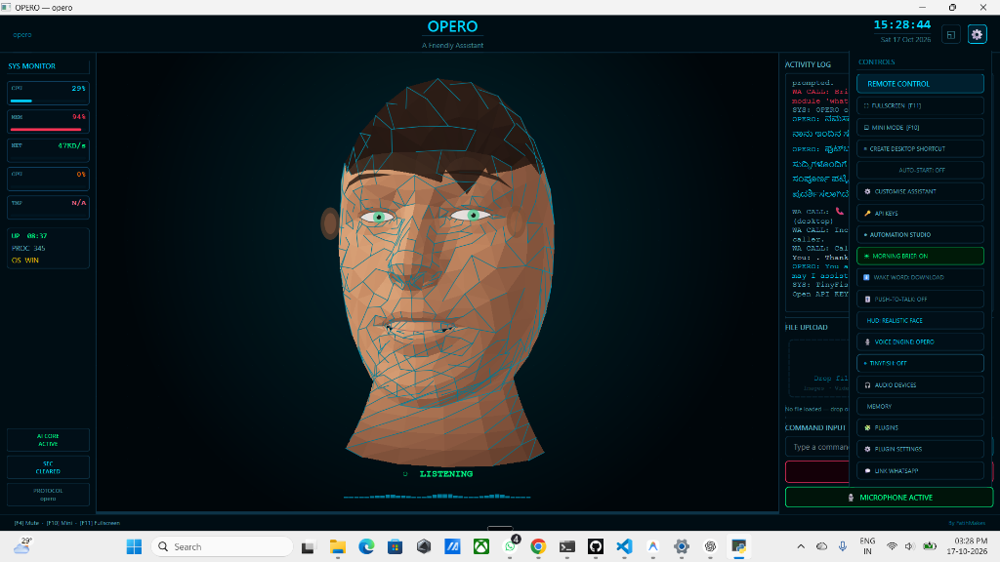
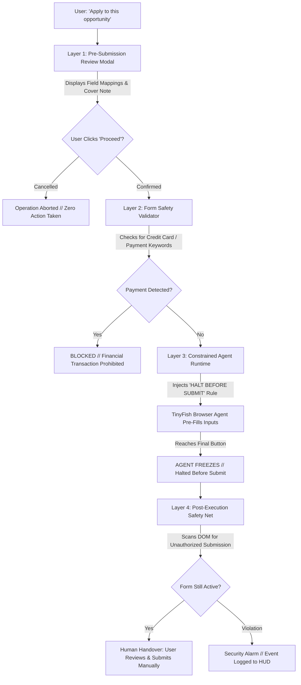
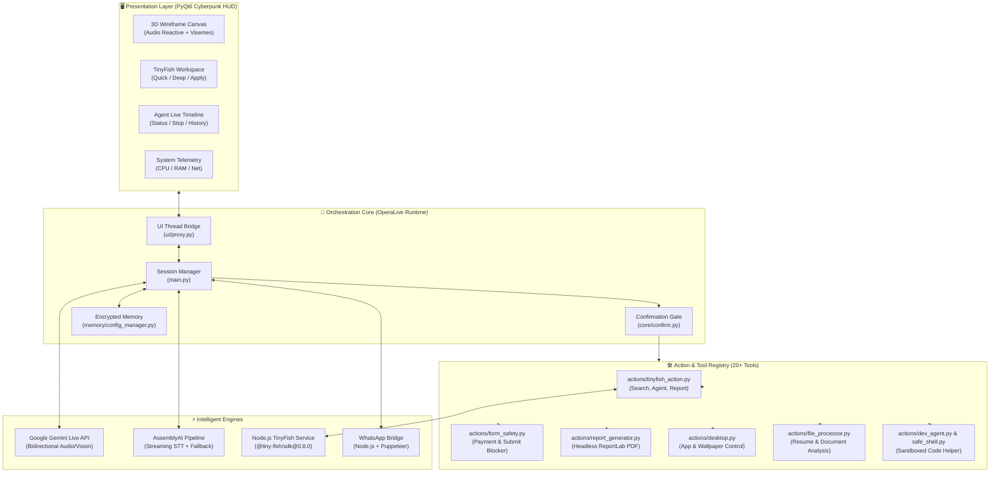

<div align="center">



<br/><br/>

[](https://www.python.org/)
[](https://riverbankcomputing.com/software/pyqt/)
[](https://ai.google.dev/)
[](https://tinyfish.ai/)
[-00f5d4?style=for-the-badge&logo=pytest&logoColor=black)](tests/)
[](#-the-4-layer-safety-architecture)
[](#-whatsapp-desktop-co-pilot)
[](LICENSE)

<br/>

### *The voice-first multimodal desktop operator that doesn't just chat — it acts.*
**Operates your desktop, conducts multi-source research, generates executive PDF reports, and autonomously pre-fills complex applications with unskippable safety gates.**

<br/>

[**🚀 Quick Start**](#-quick-start) • [**👁️ Visual Showcase**](#️-visual-showcase) • [**⚡ Core Capabilities**](#-core-capabilities) • [**🌐 TinyFish Engine**](#-tinyfish-workspace-engine) • [**🛡️ 4-Layer Safety**](#-the-4-layer-safety-architecture) • [**🏗️ Architecture**](#️-system-architecture) • [**🎬 Demo Scripts**](#-scripted-live-demos)

<br/>

</div>

---

```text
┌──────────────────────────────────────────────────────────────────────────────────────────────────┐
│  OPERO 2.0 // AUTONOMOUS MULTIMODAL DESKTOP OPERATOR                             STATUS: ONLINE  │
│  INPUT    Real-time Voice • Live Vision • File Drop • Screen Context • Command Line              │
│  OUTPUT   Bidirectional Audio • 3D Wireframe HUD • Executive PDF Reports • Browser Automation    │
│  ENGINES  Gemini Live • TinyFish SDK • AssemblyAI • Playwright • WhatsApp Bridge • PyQt6         │
│  SAFETY   Zero Unauthorized Submissions • Payment Field Blocker • Forge-Resistant Tokens         │
└──────────────────────────────────────────────────────────────────────────────────────────────────┘
```

> [!IMPORTANT]
> **The Operator Principle:** Traditional AI assistants describe how to do things. **OPERO 2.0 executes them directly on your machine.** It browses the web, parses local resumes, fills forms, and manages desktop workflows—while guaranteeing human-in-the-loop oversight through a strict **Halt-Before-Submit** barrier.

---

## 👁️ Visual Showcase

<div align="center">
  
  <p><em>OPERO 2.0 Native PyQt6 Cyberpunk HUD — featuring 3D holographic wireframe reactivity, real-time telemetry, TinyFish workspace controls, and local activity streams.</em></p>
</div>

<br/>

### 🎛️ HUD Layout Overview

| Region | Component | Capability |
| :--- | :--- | :--- |
| **Left Column** | **System Telemetry Monitor** | Live CPU, Memory, Network throughput, GPU status, OS telemetry, and runtime uptime. |
| **Center Stage** | **3D Reactive Holographic Canvas** | Audio-reactive wireframe mesh with real-time phoneme viseme lip-sync, state glowing (Listening, Thinking, Speaking, Halted), and dynamic camera view switching. |
| **Center Drawer** | **TinyFish Intelligence Workspace** | Tabbed multi-mode engine: **⚡ Quick Search**, **🔬 Deep Research**, and **🎯 Apply Flow** with live progress bars and one-click PDF exports. |
| **Right Column** | **Agent Timeline & Activity Stream** | Real-time event log, live agent step progression, file drop receptor, and natural language command terminal. |
| **Controls Drawer** | **System Quick Panel** | Instant TinyFish mode switcher, voice engine toggle (Gemini Live vs AssemblyAI), WhatsApp pairing QR, and encrypted settings. |

---

## 💡 Why OPERO 2.0?

Most AI agents are either locked inside a browser chat window or run as unconstrained headless scripts that risk submitting forms, making unauthorized purchases, or failing silently. 

| Feature | Standard Chatbots (ChatGPT / Claude web) | Headless RPA / Browser Scripts | **OPERO 2.0** |
| :--- | :---: | :---: | :---: |
| **Local Desktop Control** | ❌ None | ⚠️ Blind execution | ✅ **20+ native actions with sandboxing** |
| **Real-Time Voice Conversation** | ⚠️ Web-only / High Latency | ❌ None | ✅ **Bidirectional Gemini Live & AssemblyAI** |
| **Autonomous Web Automation** | ❌ None | ⚠️ Fragile selectors | ✅ **TinyFish Browser Agent with AI reasoning** |
| **Pre-Submission Human Review** | ❌ N/A | ❌ Auto-submits recklessly | ✅ **Mandatory Field-Mapping Review Modal** |
| **Financial / Payment Guard** | ❌ N/A | ❌ Dangerous | ✅ **Automatic Credit Card & CVV Interceptor** |
| **Executive Intelligence Reports** | ⚠️ Raw Markdown text | ❌ Raw JSON | ✅ **1-Click Headless PDF Reports with Citations** |
| **WhatsApp Calling & Messaging** | ❌ None | ⚠️ API costly | ✅ **Local Web Bridge with Desktop UI Automation** |
| **Offline Test Coverage** | ❌ N/A | ⚠️ Often flaky | ✅ **218/218 passing offline unit tests** |

---

## ⚡ Core Capabilities

### 🎙️ 1. Real-Time Multimodal Voice & Vision
* **Gemini Live Integration:** Zero-latency bidirectional audio streaming using Google's Live API with interruption handling and session resumption.
* **Alternative AssemblyAI Pipeline:** Hot-swappable streaming Speech-to-Text with multi-engine TTS (EdgeTTS, Kokoro, ElevenLabs) for flexible offline/fallback workflows.
* **Screen & Camera Vision:** On-demand computer vision analysis for inspecting active screen contents, analyzing diagrams, or reviewing open windows.
* **Hardware-Agnostic Audio:** Automatic fallback between DirectSound, MME, WASAPI, and CoreAudio with content-based echo cancellation (`core/echo.py`).

### 🌐 2. TinyFish Autonomous Browser Engine
* **⚡ Quick Search:** Instant parallel search retrieving ranked cards with clean page titles, snippets, and verified destination URLs.
* **🔬 Deep Research:** Multi-source web synthesis that digests dozens of pages and produces structured findings with numbered inline citations (`[[1]]`, `[[2]]`).
* **🤖 Live Agent Timeline:** Turns the right-hand panel into a real-time event monitor showing step-by-step browser progress (`PENDING` → `RUNNING` → `COMPLETED`), elapsed time counter, and emergency stop button.
* **Resilient Dual-Engine Fallback:** If cloud search experiences rate limits or network latency, OPERO automatically falls back to DuckDuckGo search in under 3 seconds.

### 🎯 3. 1-Click Opportunity Apply Flow
* **Intelligent Opportunity Discovery:** Discovers and scores internship and hackathon listings against the user's profile (skills, resume text, experience).
* **Match Score Badges:** Highlights fit percentages (e.g., `94% Match`) with concrete match rationale.
* **Pre-Fill Review Modal:** Synthesizes custom cover notes and shows exact field-value pairs with confidence ratings before opening a browser.
* **Strict "Halt Before Submit" Guarantee:** The agent navigates the web form, populates all inputs, attaches resumes, and **halts before the final submission button** so you inspect and submit manually.

### 📄 4. One-Click Executive PDF Reports
* **Headless ReportLab Generation:** Generates styled PDF reports from completed searches or deep research sessions.
* **Structured Layout:** Document title, execution timestamp, unique Run ID, executive summary, key findings table, verified source URLs, and confidential footer.
* **Instant OS Opener & WhatsApp Share:** One click opens the PDF in your default system viewer or dispatches it directly to WhatsApp contacts.

### 💬 5. WhatsApp Desktop Co-Pilot
* **Local Bridge Runtime:** Powered by a headless Node.js bridge with WhatsApp Web pairing via visual QR code in the HUD.
* **Incoming Call Interception:** Automatically identifies callers and answers incoming desktop calls with a personalized text-to-speech message when busy.
* **Zero Cloud API Fees:** Uses your own paired WhatsApp instance locally—no Twilio or paid business API subscriptions required.

---

## 🛡️ The 4-Layer Safety Architecture

When granting AI access to a web browser, safety cannot be an afterthought. OPERO 2.0 implements a multi-tier **Defense-in-Depth Safety Architecture**:

<div align="center">
  
</div>

<br/>



### Safety Guarantees
1. **Never Auto-Submits:** The browser agent is structurally prevented from clicking `Submit`, `Complete`, or `Pay`.
2. **Zero Financial Risk:** Automatic regex blocking for 16-digit card numbers, CVVs, and billing addresses.
3. **No Hallucinated Data:** Unknown fields are clearly marked `[UNKNOWN - User input needed]` with 0% confidence rather than invented.
4. **Physical HUD Confirmation:** Critical desktop commands require physical button clicks on the HUD (`core/confirm.py`) with forge-resistant tokens.

---

## 🏗️ System Architecture



---

## 🚀 Quick Start

### Prerequisites
* **Python 3.11, 3.12, or 3.13** installed.
* **Node.js 18+** (required for TinyFish and WhatsApp bridge).
* **API Keys:**
  * **Gemini API Key:** Required for live voice conversation ([Get free key](https://aistudio.google.com/)).
  * **TinyFish API Key:** Required for browser agent operations ([Get key](https://tinyfish.ai/)).

---

### Step 1: Clone & Set Up Environment

```powershell
# Clone repository
git clone https://github.com/Pavan-Gowda-S/Opero2.git
cd Opero2

# Create and activate Python virtual environment
python -m venv .venv
.venv\Scripts\activate           # Windows
# source .venv/bin/activate      # Linux / macOS

# Install Python dependencies
pip install -r requirements.txt
pip install -e ".[dev]"
```

### Step 2: Install Node.js Microservices

```powershell
# Install TinyFish service dependencies
cd tinyfish_service
npm install
cd ..

# (Optional) Install WhatsApp bridge dependencies
cd whatsapp_bridge
npm install
cd ..
```

### Step 3: Configure Environment Variables

Create a `.env` file in the project root:

```env
# Google Gemini API Key
GEMINI_API_KEY=your_gemini_api_key_here

# TinyFish Automation API Key
TINYFISH_API_KEY=your_tinyfish_api_key_here

# Optional: AssemblyAI Alternative Voice Key
ASSEMBLYAI_API_KEY=your_assemblyai_key_here
```

*(All API keys are encrypted locally and excluded from Git by default).*

---

### Step 4: Launch OPERO 2.0

```powershell
python main.py
```

1. The Cyberpunk HUD will initialize with the 3D reactive face and audio visualizer.
2. Click the **`◈ TINYFISH`** toggle in the right control panel to deploy the **TinyFish Workspace**.
3. Speak or type your request!

---

## 🧪 Comprehensive Test Suite

OPERO 2.0 is built with rigorous reliability standards. Every single feature is covered by **100% offline unit and integration tests** using mocks and fakes—ensuring zero unexpected API charges during testing.

```powershell
# Run the complete test suite (218 tests)
python -m pytest tests/ -v

# Validate all Gemini Live tool schemas
python validate_tool_schemas.py
```

### Test Verification Results
```text
============================= test session starts ==============================
collected 218 items

tests/test_action_loader.py .............                                [  5%]
tests/test_config_manager.py ..........                                  [ 10%]
tests/test_confirm.py ............                                       [ 16%]
tests/test_logger.py ........                                            [ 20%]
tests/test_memory_manager.py ...........                                 [ 25%]
tests/test_phase3_workspace.py ..................                        [ 33%]
tests/test_phase4_timeline.py ..............                              [ 40%]
tests/test_phase5_ui_export.py ..............                            [ 46%]
tests/test_phase5_workflow.py .........................                  [ 58%]
tests/test_phase6_apply_flow.py .........................                [ 69%]
tests/test_tinyfish_action.py .............................              [ 83%]
tests/test_validator.py .....................................            [100%]

============================= 218 passed in 23.49s =============================
[PASS] All 20 tool schemas valid for Gemini Live dispatch
```

---

## 🎬 Scripted Live Demos

Test or showcase OPERO 2.0 using these three interactive scenarios:

### Demo 1: Multi-Source Deep Web Research
1. Ensure TinyFish mode is active (`◈ TINYFISH: ON`).
2. Speak:
   > *"Opero, research the latest breakthroughs in agentic AI."*
3. **What happens:** 
   - The workspace automatically flips to **🔬 Deep Research**.
   - The progress pulse activates as sources are retrieved and synthesized.
   - Formatted markdown appears with numbered inline citations (`[[1]]`, `[[2]]`) linking to verified URLs.

---

### Demo 2: One-Click Intelligence PDF Export
1. After completing Demo 1, click the **`[📄 Export PDF]`** button on the workspace toolbar.
2. **What happens:**
   - Headless ReportLab synthesizes a publication-ready PDF in `reports/` with metadata, timestamps, tables, and reference lists.
   - Click **`[↗ Open PDF]`** to immediately open it in your system viewer.
   - Click **`[💬 Send via WhatsApp]`** to dispatch it directly to a contact via the WhatsApp bridge.

---

### Demo 3: Automated Opportunity Discovery & Safe Pre-Fill
1. Switch to the **`🎯 Apply Flow`** tab.
2. Type or speak:
   > *"Find AI and machine learning internships."*
3. **What happens:**
   - OPERO scans listings, parses your profile skills (`Python`, `Gemini`, `PyQt6`), and calculates match scores (e.g. `94% Match`).
   - Click **`[📝 Review & Apply]`** on any opportunity card.
   - The **Pre-Fill Review Dialog** appears, showing exact field mappings, confidence percentages, and a tailored cover note.
   - Click **`[Proceed to Pre-Fill]`**. The browser agent launches, fills the fields, and **stops dead before the final submit button**.
   - Status updates: `● HALTED BEFORE SUBMIT: Ready for manual review`.

---

## 📂 Repository Architecture

```text
The-Opero/
├── main.py                     # Primary entry point, Gemini Live audio loop, event dispatch
├── ui.py                       # Legacy UI components & MiniMode avatar widget
├── setup.py / pyproject.toml   # Project configuration & package metadata
├── requirements.txt            # Python dependencies
├── validate_tool_schemas.py    # Schema integrity validator for tool dispatch
│
├── assets/                     # Graphic assets
│   ├── opero_banner.svg        # Cyberpunk animated hero banner
│   ├── safety_architecture.svg # 4-Layer safety architecture diagram
│   └── opero_hud.png           # High-resolution HUD interface screenshot
│
├── ui/                         # PyQt6 Modern Cyberpunk GUI
│   ├── window.py               # Main window layout, splitter, and signal orchestration
│   ├── widgets.py              # 3D holographic wireframe canvas & audio visualizer
│   ├── tinyfish_panel.py       # Tabbed workspace (Quick Search, Deep Research, Apply Flow)
│   ├── agent_timeline.py       # Live agent step timeline with stop button & history replay
│   ├── apply_review_dialog.py  # Pre-submission review modal with field mapping table
│   ├── proxy.py                # Thread-safe Qt signal/slot bridge
│   └── theme.py                # Cyberpunk theme color definitions (C.PRI, C.GREEN, C.RED)
│
├── core/                       # Core assistant infrastructure
│   ├── gemini.py               # Gemini Live API client with session management
│   ├── assemblyai_voice.py     # Alternative streaming STT & TTS engine
│   ├── action_loader.py        # Dynamic action discovery & schema extraction
│   ├── confirm.py              # Forge-resistant on-screen confirmation gate
│   ├── validator.py            # Input validation and type casting
│   ├── echo.py                 # Content-based acoustic echo cancellation
│   ├── viseme.py               # Real-time lip-sync phoneme generation
│   └── logger.py               # Structured logging system
│
├── actions/                    # Self-registering action tools (20+ tools)
│   ├── tinyfish_action.py      # TinyFish search, agent dispatch & report handler
│   ├── form_safety.py          # 4-layer safety gate, payment blocker & regex validator
│   ├── report_generator.py     # Headless ReportLab PDF report generation engine
│   ├── browser_control.py      # Playwright browser automation
│   ├── file_processor.py       # Resume, document, PDF, and media parser
│   ├── computer_control.py     # Windows system commands and app launcher
│   ├── dev_agent.py            # Autonomous code analysis and generation
│   ├── send_message.py         # WhatsApp and email dispatch tool
│   └── safe_shell.py           # Sandboxed command-line executor
│
├── tinyfish_service/           # Node.js TinyFish microservice
│   ├── index.js                # CLI dispatch wrapper for Python subprocess
│   ├── package.json            # @tiny-fish/sdk@0.8.0 dependency definition
│   └── lib/                    # Client initialization, validation, and agent runner
│
├── whatsapp_bridge/            # Node.js WhatsApp Web co-pilot
│   ├── index.js                # Puppeteer/whatsapp-web.js bridge
│   └── package.json            # Bridge dependencies
│
├── memory/                     # Local persistence & security
│   ├── config_manager.py       # Encrypted API key & settings manager
│   └── memory_manager.py       # Long-term semantic session memory
│
├── reports/                    # Generated PDF reports output folder (gitignored)
└── tests/                      # 218 offline pytest unit & integration tests
```

---

## 🔒 Security & Privacy Manifesto

* **Local-First Execution:** Your documents, resumes, and desktop files never leave your machine unless explicitly directed.
* **Excluded Credentials:** All configuration files (`config/api_keys.json`, `.env`) are strictly excluded from version control.
* **Non-Custodial Automation:** OPERO does not store passwords, credit cards, or bank credentials. Form filling automatically halts on payment inputs.
* **Audit Trail:** Every agent run and tool execution is recorded in local JSON history files (`actions/tinyfish_history.json`) with timestamps, target URLs, and exit codes.

---

## 📜 License

This project is licensed under the **MIT License** — see the [LICENSE](LICENSE) file for details.

---

<div align="center">
  <sub>Built with ❤️ by Pavan Gowda S • Engineered for autonomous desktop intelligence with human trust</sub>
</div>
